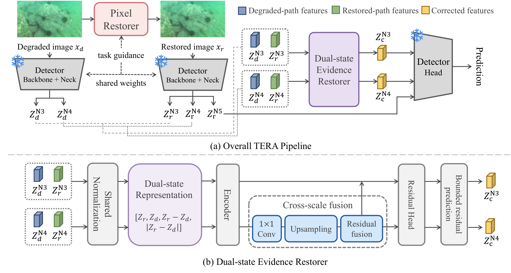

# TERA: Task-Evidence Restoration for Underwater Object Detection under Bandwidth-Constrained Transmission

Official code for **TERA** and the **AquaTX** benchmark (WACV 2027, Applications Track).

Underwater images sent over bandwidth-limited acoustic or RF links are downscaled and lossily compressed before they reach the receiver. **AquaTX** applies controlled resize and codec degradation (JPEG, WebP and JPEG2000 for training and evaluation, plus AVIF as an unseen codec) to the DUO and RUOD detection datasets. **TERA** restores the task evidence that transmission removed. It does this at the receiver, using only the decoded RGB image and keeping the detector **fully frozen**:

1. A **task-guided pixel restorer** uses the frozen backbone's P3/P4 features to predict a bounded, gated RGB residual.
2. A **dual-state evidence restorer** compares the detector's late neck features for the degraded and the restored image. It then corrects the N3/N4 levels before they reach the frozen detection head.

TERA never uses transmission metadata (codec, bitrate or size), neither in training nor at inference.

<p align="center"></p>

*Overview of TERA. (a) The pixel restorer uses frozen backbone P3/P4 features as task guidance; the dual-state evidence restorer refines N3/N4 from the degraded and restored feature states, and N5 follows the restored path. (b) Dual-state evidence restorer.*

## Results (mAP50:95, %, AquaTX test)

| Dataset | Method | Detector | Clean | Resize-only (3) | Codec-only (9) | Seen compound (27) | Unseen AVIF (9) |
|---|---|---|---:|---:|---:|---:|---:|
| DUO-TX | Clean-YOLO | frozen | 65.7 | 60.3 | 57.0 | 37.7 | 42.2 |
| DUO-TX | DegFT-YOLO | fine-tuned | 61.4 | 59.9 | 58.2 | 48.1 | 50.8 |
| DUO-TX | **TERA** | frozen | **66.4** | **65.7** | **61.9** | **50.0** | **53.2** |
| RUOD-TX | Clean-YOLO | frozen | 51.5 | 48.4 | 46.0 | 31.5 | 35.7 |
| RUOD-TX | DegFT-YOLO | fine-tuned | 48.6 | 48.0 | 47.0 | **41.4** | 43.1 |
| RUOD-TX | **TERA** | frozen | **52.1** | **51.0** | **49.2** | 41.3 | **43.2** |

Numbers are from Table 3 of the paper, evaluated with `tools/evaluate.py` on the frozen AquaTX test assets (YOLOv8s at 640×640). Retraining with `scripts/train_*.sh` gives comparable results; small differences between training runs are expected.

## Installation

```bash
git clone https://github.com/hijinkim/TERA.git && cd TERA
conda create -n tera python=3.10 -y && conda activate tera
pip install torch==2.7.1 torchvision==0.22.1 --index-url https://download.pytorch.org/whl/cu128
pip install -r requirements.txt
```

The transmission operator is deterministic. With the pinned Pillow and OpenCV versions, rendering a condition on the fly reproduces the released frozen assets bit for bit. Other versions of libjpeg, libwebp, OpenJPEG or libavif can change the decoded pixels slightly.

## Data

### AquaTX test assets (for evaluation)

Download `AquaTX_DUO-TX_test.zip` and `AquaTX_RUOD-TX_test.zip` from **[Google Drive](https://drive.google.com/drive/folders/1oO5lnx8-A1BMnlRCYSDdhSFXYfT956Bp)** and extract both into `data/`:

```
data/AquaTX/
├── DUO-TX/test/conditions/<condition>/images/*.png    # 52 conditions x 1,111 images
└── RUOD-TX/test/conditions/<condition>/images/*.png   # 52 conditions x 1,255 images
```

Each `test/` folder also contains `manifest.csv` and `protocol.json`. The manifest lists every image's target and achieved rate, encoded size, selected codec parameter and SHA-256. `protocol.json` records the operator and the library versions.

Condition names:

| Condition | Meaning |
|---|---|
| `clean` | Clean reference |
| `resize_l{0256,0384,0512}` | Resize only |
| `seen_codeconly_{jpeg,webp,jpeg2000}_l0640_b{030,060,100}` | Compression at full size, 0.30/0.60/1.00 bits per transmitted pixel |
| `seen_compound_{codec}_l{0256,0384,0512}_b{030,060,100}` | Resize and compression |
| `unseen_{codeconly,compound}_avif_*` | Held-out AVIF codec |

### Source images (for training)

Training renders transmission degradation online from the original images, so the original datasets are required:

- DUO: <https://github.com/chongweiliu/DUO>. Training images go in `data/DUO/images/train`.
- RUOD: <https://github.com/dlut-dimt/RUOD>. Training images go in `data/RUOD/images/train`.

The splits used in the paper are in `splits/` as COCO-format JSON files that reference images by file name:

| | train | val | test |
|---|---:|---:|---:|
| `splits/duo` | 6,003 | 668 | 1,111 (official test) |
| `splits/ruod` | 2,712 | 301 | 1,255 |

In both datasets, validation images are taken from the official training set. **RUOD-TX uses the four categories RUOD shares with DUO** (holothurian, echinus, scallop, starfish). It keeps the official RUOD images that contain at least one of these categories: 1,255 of the 4,200 test images, and 3,013 of the 9,800 training images, which are split 2,712 / 301. The test sets are never used for checkpoint selection or tuning.

## Evaluation

```bash
python tools/evaluate.py --dataset duo \
    --checkpoint runs/duo/tera/best.pth --detector runs/detector/clean_duo/weights/best.pt \
    --degft runs/detector/degft_duo/weights/best.pt --aquatx-root data/AquaTX/DUO-TX/test \
    --output results/duo_test.json
```

The script reports per-condition and per-group mAP for four variants: `raw` (Clean-YOLO on the received image), `pixel_only` (Clean-YOLO on the restored image), `tera`, and `degft`. `bash scripts/eval.sh` evaluates both datasets with the checkpoints written by `scripts/train_duo.sh` and `scripts/train_ruod.sh`. To render conditions from the original test images instead of reading the frozen assets, add `--online --image-dir data/DUO/images/test`.

## Computational profiling

```bash
python tools/measure_compute.py --checkpoint runs/duo/tera/best.pth --detector runs/detector/clean_duo/weights/best.pt
```

The script reports parameters, detector backbone/neck passes, GFLOPs, latency and peak memory for one 640×640 image at batch size 1 with bf16 autocast. TERA runs the frozen backbone and neck twice (once on the degraded image, once on the restored image) and requires 168.7 GFLOPs, compared with 28.4 GFLOPs for the detector alone.

## Demo

```bash
python tools/demo.py --checkpoint runs/duo/tera/best.pth --detector runs/detector/clean_duo/weights/best.pt \
    --input path/to/images --simulate 256 jpeg 0.3 --compare --output outputs/demo
```

`--simulate LONG_SIDE CODEC BPP` applies an AquaTX transmission condition first. Without it, the input is treated as an already-received image. `--compare` also saves the frozen detector's output without TERA.

## Training

The full pipelines are in `scripts/train_duo.sh` and `scripts/train_ruod.sh`. The stages are:

| Stage | Command | Paper setting |
|---|---|---|
| 1. Detectors | `tools/train_detector.py --mode clean` / `--mode degft` | YOLOv8s, up to 100 epochs (clean) / 50 epochs (DegFT, initialized from clean), early stopping on validation mAP |
| 2. Pixel restorer | `tools/train_pixel_restorer.py` | 20 epochs, batch 4 (per dataset) |
| 3. Neck statistics | `tools/precompute_neck_stats.py` | 4,096 restored training images |
| 4. Joint TERA | `tools/train_tera.py` | DUO: batch 20, 6,000 steps. RUOD: batch 16, 5,000 steps |

Notes:

- Training samples are degraded online using a mixture of 10% clean, 10% resize-only, 10% codec-only and 70% compound conditions. Only the three seen codecs are used; AVIF is never used for training or model selection.
- In joint training (Sec. 4.3), the pixel restorer starts from the stage-1 checkpoint and the evidence restorer starts as an identity correction (zero-initialized heads). The objective is L = L_GT + λ_KD·L_KD + λ_id·L_id + λ_res·L_res (Eq. 11) with λ_KD = 1, λ_dfl = 0.1, λ_id = 0.5 and λ_res = 1e-3. L_KD uses the pre-transmission image as the teacher and is restricted to the assigner's foreground anchors (Eq. 12). L_id and L_res are the L1 norms of the normalized residuals r of the evidence restorer (Eq. 9, 13–14), averaged over elements and summed over N3/N4; L_id is computed on the transmission-free inputs of the batch and L_res on the transmission-degraded ones. Checkpoints are selected on three validation conditions.
- **No transmission metadata at any stage.** Every training target comes from the (received, pre-transmission) image pair, the ground-truth boxes or the frozen detector. Transmission-free samples (needed for L_id and the stage-1 identity term) are identified by comparing the two images, not from condition labels.
- DUO-TX and RUOD-TX are trained independently: every stage (detectors, pixel restorer, neck statistics, joint training) uses only the corresponding dataset.

## Repository structure

```
tera/
  transmission.py      AquaTX operator (resize -> codec at target bpp -> upsample -> letterbox)
  data.py              online / frozen datasets
  detector.py          frozen YOLOv8 wrapper (backbone P3/P4, neck N3/N4/N5, Detect head)
  pixel_restorer.py    task-guided pixel restorer (Sec. 4.1)
  evidence_restorer.py dual-state evidence restorer (Sec. 4.2)
  model.py             TERA assembly and checkpoint I/O
  pretrain_losses.py   stage-1 objective
  degft.py             Ultralytics trainer with online AquaTX degradation
  metrics.py           decoding, NMS, COCO mAP
tools/                 train_detector, train_pixel_restorer, precompute_neck_stats, train_tera, evaluate,
                       measure_compute, demo
splits/                DUO / RUOD split annotations
configs/aquatx.json    transmission protocol
```

## Citation

```bibtex
@inproceedings{tera2027,
  title     = {TERA: Task-Evidence Restoration for Underwater Object Detection under Bandwidth-Constrained Transmission},
  author    = {Kim, Heejin and Song, Joon-Seok and Park, Eunil},
  booktitle = {Proceedings of the IEEE/CVF Winter Conference on Applications of Computer Vision (WACV)},
  year      = {2027}
}
```

## Acknowledgements

This code builds on [Ultralytics YOLOv8](https://github.com/ultralytics/ultralytics) and uses the [DUO](https://github.com/chongweiliu/DUO) and [RUOD](https://github.com/dlut-dimt/RUOD) datasets.
